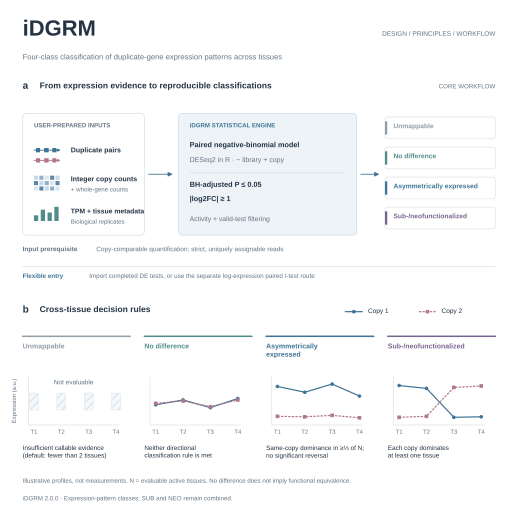

# iDGRM 2.0.0

iDGRM classifies duplicate-gene expression patterns across tissues. It assigns four expression-pattern classes from tissue-level differential-expression evidence and measured expression activity.



## Scope

The primary module assigns four classes: **Unmappable**, **No difference**, **Asymmetrically expressed**, and **Sub-/neofunctionalized**.

Subfunctionalization and neofunctionalization remain combined as **Sub-/neofunctionalized**. This software reports expression patterns rather than demonstrated functional changes.

The four-class framework follows Lan and Pritchard (2016), with explicitly documented statistical adaptations. Defaults are **BH-adjusted P ≤ 0.05** and **absolute log2FC ≥ 1**, rather than the publication's paired t-test with P < 0.001. Within-tissue BH adjustment does not guarantee false discovery rate control for the final expression classes.

## Dependencies and installation

Python **3.10 or later** is required. The Python package depends on NumPy, pandas, and SciPy.

**The raw-count workflow requires R and DESeq2.** Installing iDGRM with pip does not install R or DESeq2; install these separately and make `Rscript` available on your PATH, or provide its location with `--rscript`.

| Command or input route | R/DESeq2 required locally? |
|---|---|
| `fit-copy-counts`: differential testing of raw integer counts | **Yes**; calls the actual R/DESeq2 engine |
| `classify-primary --differential-expression-dir`: import completed differential tests | No; compatible test results must already exist |
| `classify-primary --expression-matrix`: log-expression paired t-test | No; this is a distinct statistical route, not a Python implementation of DESeq2 |

Download the wheel or source archive from the [2.0.0 release](https://github.com/lihongxiang97/iDGRM/releases/tag/v2.0.0). From an extracted source directory:

```bash
python -m pip install .
idgrm --version
idgrm --help
python -m unittest discover -s tests -v
```

## Four-class classification

Fit differential expression using raw integer counts from comparable, reliably assignable regions. Alternatively, import compatible differential-expression results generated beforehand.

```bash
idgrm fit-copy-counts \
  --counts whole_gene_counts.tsv \
  --copy1-counts comparable_copy1_counts.tsv \
  --copy2-counts comparable_copy2_counts.tsv \
  --duplicate-pairs pairs.tsv --sample-metadata samples.tsv \
  --observability-method reciprocal-common-cds \
  --output-dir results/count_tests

idgrm classify-primary \
  --differential-expression-dir results/count_tests \
  --activity-expression-matrix tpm.tsv \
  --activity-sample-metadata samples.tsv \
  --duplicate-pairs pairs.tsv --output-dir results/primary
```

The first column of the whole-gene count matrix contains gene IDs. The first column of each copy-specific matrix contains `pair_id`; the remaining columns contain sample counts in the same order as `samples.tsv`. Sample metadata must include `sample_id`, `tissue`, and `replicate`; the pair table must include `pair_id`, `gene1`, and `gene2`. Each tissue requires at least two independent biological libraries; three or more are recommended. Merge technical replicates before analysis. TPM is used for activity assessment and visualization, not as input to the DESeq2 model.

`--observability-method` records a user-supplied description of count provenance. It does not perform read swapping or verify mappability. The two copies must have comparable effective lengths or observable regions; uniquely mapping reads from one copy alone do not eliminate length and assignment biases. The `uncorrected` setting is intended for diagnostics and is not recommended for biological interpretation.

An independent log-expression paired t-test route is also available. It is not a reimplementation of DESeq2:

```bash
idgrm classify-primary --expression-matrix examples/expression.tsv \
  --sample-metadata examples/samples.tsv --duplicate-pairs examples/pairs.tsv \
  --output-dir results/example_primary
```

Outputs are `primary_classifications.tsv`, `tissue_evidence.tsv`, `primary_summary.tsv`, and `primary_run_metadata.json`. The machine-readable code `UNMAPPED` is retained for compatibility and displayed as Unmappable. This category also includes insufficient expression evidence: it does not, by itself, establish that a pair is genuinely unmappable. Consult `assessment_status`, `mapping_status`, and the classification reason. No difference means that the specified directional rules were not met, not that the copies have identical functions.

## Methods, limitations, and reproducibility

- [Methods and differences from the reference publication (Chinese)](docs/METHODOLOGY_CN.md)
- [2.0.0 release notes and migration](docs/RELEASE_2.0.0.md)
- [Software design figure and legend](docs/FIGURE1.md)

Run metadata records parameters, input SHA-256 checksums, and output integrity hashes. Existing output files are not silently overwritten. Version 2.0.0 removes the previous outgroup polarization and historical subtype-refinement interfaces, associated parameters, and example data. Primary classification thresholds are unchanged.

In this release, stability refers to supported interfaces, rule execution, error handling, and reproducibility. It does not imply established biological accuracy or error control under every experimental condition. Small sample sizes, high dispersion, limited tissue coverage, and assignment bias between similar copies remain important limitations.

## References

Lan X, Pritchard JK. Coregulation of tandem duplicate genes slows evolution of subfunctionalization in mammals. Science 352, 1009–1013 (2016). DOI: [10.1126/science.aad8411](https://doi.org/10.1126/science.aad8411).

For DESeq2 methods and installation guidance, see the [official DESeq2 documentation](https://www.bioconductor.org/packages/release/bioc/vignettes/DESeq2/inst/doc/DESeq2.html). Using iDGRM does not replace assessment of experimental design, data quality, and statistical assumptions.
